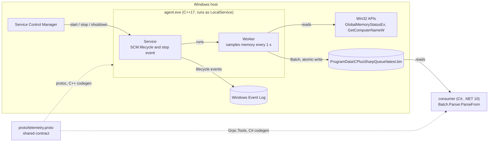
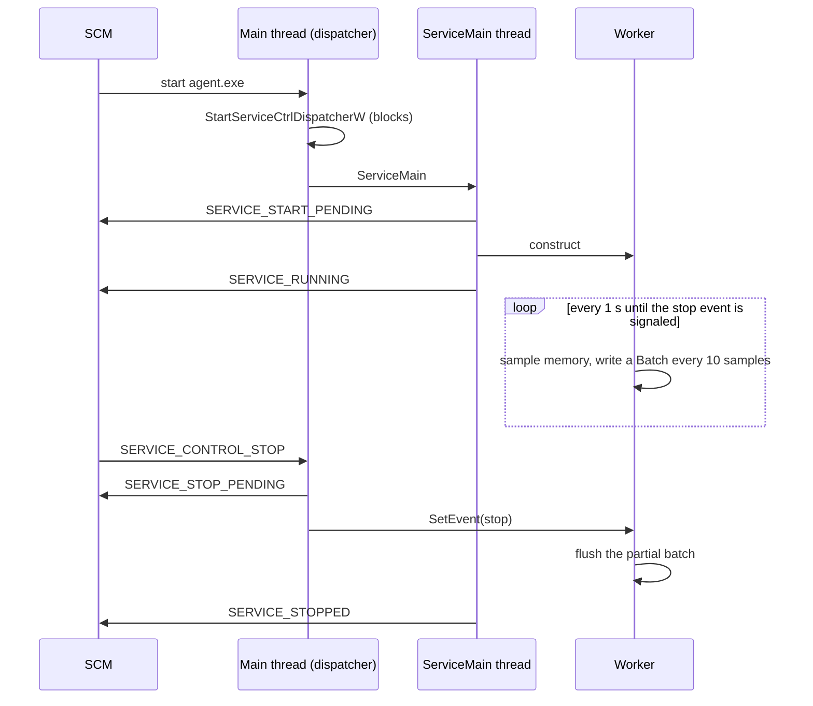

# CPlusSharpQueue

A Windows telemetry pipeline: a native **C++ Windows service** samples system metrics, serializes them with
**Protocol Buffers**, and a **C# client** reads and decodes them. The `.proto` contract is the only thing the two
languages share.

This is a study project. It explores the parts that come up when shipping native agents to Windows endpoints:
service lifecycle under the Service Control Manager (SCM), least-privilege service accounts, a cross-language
binary contract, x64 and ARM64 builds, and memory behavior of long-running processes.

## Main parts

| Part | Folder | What it does |
|---|---|---|
| Telemetry service | `agent/` | C++17 executable that runs as a Windows service (or in a console for debugging). Samples physical memory every second, groups 10 samples into a `Batch` and writes it to disk atomically |
| Protobuf contract | `proto/` | `telemetry.proto`, the single source of truth for the message format. Compiled to C++ by `protoc` at build time and to C# by `Grpc.Tools` |
| C# client | `consumer/` | .NET 10 console app that reads the latest batch and decodes it with the generated `Batch` parser |
| Scripts | `scripts/` | Install and uninstall the service (administrator PowerShell) |

## Architecture



### Service lifecycle



The control handler only reports `STOP_PENDING` and signals an event, then returns, because it runs on the
dispatcher thread and the SCM expects a fast answer. The worker waits on that event with
`WaitForSingleObject(stopEvent, 1000)`, which is both the sampling interval and the stop signal, so a stop
request is handled immediately instead of after the next sleep.

### Message contract

```proto
message Sample { uint64 timestamp_unix_ms = 1; float cpu_percent = 2; uint64 mem_used_bytes = 3; }
message Batch  { string host = 1; Architecture architecture = 2; uint64 sequence = 3;
                 uint64 mem_total_bytes = 4; repeated Sample samples = 5; }
```

- `architecture` is resolved at compile time (`_M_X64` or `_M_ARM64`), so the same source identifies its own build.
- `sequence` increases with every batch, so a reader can detect gaps.
- `cpu_percent` is part of the contract but not sampled yet.

### Design notes

- **Atomic hand-off.** Each batch is written to `latest.bin.tmp` and renamed over `latest.bin` with
  `MoveFileExW(MOVEFILE_REPLACE_EXISTING)`. A reader never sees a half-written file.
- **Least privilege.** The service runs as `NT AUTHORITY\LocalService`. The binary lives in `Program Files`
  (writable only by administrators) and the service can only write to `ProgramData\CPlusSharpQueue`.
- **Quoted service path.** The binary path is registered with quotes to avoid the unquoted service path issue.
- **Crash recovery.** The SCM restarts the service 5 seconds after an abnormal exit.
- **RAII.** `Service` owns the stop event (non-copyable), `Worker` owns and reuses one `Batch` message.
- **C++17 on purpose.** The vcpkg Protobuf build uses C++17. Compiling the app as C++20 changes the type of an
  internal Protobuf global and breaks the Release link. Dependencies and application must share the language
  standard and runtime.

## Repository layout

```
agent/                C++ service: main.cpp, service.hpp/.cpp, worker.hpp/.cpp
proto/                telemetry.proto and its CMake target (telemetry_proto)
consumer/             C# client (Consumer.csproj)
scripts/              installService.ps1, uninstallService.ps1
CMakePresets.json     configure presets x64 and arm64, build presets x64-debug, x64-release, arm64-release
vcpkg.json            C++ dependencies (protobuf), manifest mode
CPlusSharpQueue.slnx  .NET solution
```

## Prerequisites

- Windows 10 or 11
- Visual Studio 2026 with the "Desktop development with C++" workload (the presets use the
  `Visual Studio 18 2026` generator). For ARM64 builds, also the MSVC ARM64 build tools component
- CMake 3.28 or newer
- [vcpkg](https://github.com/microsoft/vcpkg), with the `VCPKG_ROOT` environment variable pointing to it
- .NET 10 SDK

## Build

C++ service (vcpkg installs Protobuf automatically on the first configure, which takes 20 to 30 minutes):

```powershell
cmake --preset x64                      # configure, installs dependencies
cmake --build --preset x64-debug        # build\x64\agent\Debug\agent.exe
cmake --build --preset x64-release      # build\x64\agent\Release\agent.exe (used by the installer)
```

ARM64 cross-compilation from an x64 machine:

```powershell
cmake --preset arm64
cmake --build --preset arm64-release    # build\arm64\agent\Release\agent.exe
```

C# client:

```powershell
dotnet build consumer
```

## Run in a console

Console mode runs the same code without the SCM, writing to `.\data` under the current directory.
Run it from the repository root:

```powershell
.\build\x64\agent\Debug\agent.exe --console
```

Wait at least 10 seconds, then press `Ctrl+C`. The partial batch is flushed before exit.
Read the result with the C# client (default path is `data\latest.bin`):

```powershell
dotnet run --project consumer
dotnet run --project consumer -- path\to\latest.bin    # any other file
```

## Test

There are no automated tests yet. Verification is manual:

1. **Contract round trip:** run the agent in a console, stop it, and check that the client prints the host name,
   architecture, sequence and samples.
2. **Service lifecycle:** install the service (next section) and go through the checks in
   [Control and inspect the service](#control-and-inspect-the-service): it reaches `RUNNING`, writes
   `latest.bin` with an increasing `sequence`, stops in under 2 seconds with a partial final batch, and is
   restarted by the SCM after being killed.

## Install and uninstall the service

Open PowerShell **as administrator** at the repository root. Build `x64-release` first.

```powershell
powershell -ExecutionPolicy Bypass -File .\scripts\installService.ps1
```

The install script:

1. Copies `agent.exe` to `C:\Program Files\CPlusSharpQueue`.
2. Creates `C:\ProgramData\CPlusSharpQueue` and grants `LocalService` modify rights on it.
3. Registers the service `CPlusSharpQueue` (display name "CPlusSharpQueue telemetry agent"), manual start,
   quoted binary path.
4. Sets the account to `NT AUTHORITY\LocalService` and the recovery action to restart after 5 seconds.
5. Starts the service.

```powershell
powershell -ExecutionPolicy Bypass -File .\scripts\uninstallService.ps1
```

The uninstall script stops the service, deletes it and removes the binary from `Program Files`. Collected data in
`ProgramData` is kept on purpose.

**After a rebuild**, uninstall before installing again: Windows does not allow overwriting the executable of a
running service.

## Control and inspect the service

State and control (start and stop need an administrator shell):

```powershell
Get-Service CPlusSharpQueue                        # Status: Running / Stopped
Start-Service CPlusSharpQueue
Stop-Service CPlusSharpQueue                       # waits until STOPPED
Restart-Service CPlusSharpQueue
Measure-Command { Stop-Service CPlusSharpQueue }   # how long a clean stop takes
```

Configuration as the SCM sees it:

```powershell
sc.exe query CPlusSharpQueue                # state, exit codes
sc.exe qc CPlusSharpQueue                   # binary path, start type, account (SERVICE_START_NAME)
sc.exe qfailure CPlusSharpQueue             # recovery actions
Get-CimInstance Win32_Service -Filter "Name='CPlusSharpQueue'" |
    Select-Object Name, State, StartMode, StartName, ProcessId, PathName
```

Use `sc.exe`, not `sc`: in PowerShell, `sc` is an alias for `Set-Content`.

Process, session and permissions:

```powershell
Get-Process agent | Select-Object Id, SessionId, WorkingSet64, PrivateMemorySize64   # SessionId 0 for a service
icacls C:\ProgramData\CPlusSharpQueue       # LocalService should have (M) modify rights
```

Read the data written by the service:

```powershell
dotnet run --project consumer -- C:\ProgramData\CPlusSharpQueue\latest.bin
```

Crash recovery (administrator):

```powershell
taskkill /F /IM agent.exe
Start-Sleep -Seconds 6
sc.exe query CPlusSharpQueue                # RUNNING again
```

Event Log:

```powershell
# SCM events in the System log: 7045 = service installed, 7031 = terminated unexpectedly
Get-WinEvent -FilterHashtable @{ LogName = 'System'; ProviderName = 'Service Control Manager'; Id = 7045, 7031 } -MaxEvents 50 |
    Where-Object Message -like '*CPlusSharpQueue*' |
    Format-List TimeCreated, Id, Message

# Lifecycle events written by the service itself in the Application log
Get-WinEvent -LogName Application -MaxEvents 500 |
    Where-Object ProviderName -eq 'CPlusSharpQueue' |
    Format-List TimeCreated, LevelDisplayName, Message
```

Recent Windows versions do not log event 7036 (normal state changes) for services, which is why the agent
writes its own start and stop events. The source is not registered with a message file, so Event Viewer shows a
"description cannot be found" notice next to the text. The `Where-Object` filter is used because
`-FilterHashtable` rejects providers that are not registered.

## Roadmap

- Named pipe transport between agent and client, with length-prefixed framing
- CPU and per-process memory sampling, pre-allocated ring buffer, Protobuf arenas
- Schema evolution test: a v2 producer read by a v1 consumer
- C ABI bridge so C# can call the C++ collector through P/Invoke
- The same collector as a C# Worker Service, with memory and startup comparison against the C++ version
- ARM64 review of the ring buffer with explicit `memory_order` acquire/release
